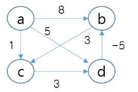
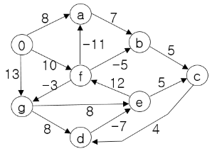

# 알고리즘 족보 문항과 정답 (확인용)

앱의 "족보만 풀기"에 들어 있는 기존 족보 문항 53개입니다(족보관련 생성 문항·일반 문항은 제외). 데이터: `data/subjects/algorithm/<챕터>.ts` 중 족보 문항.

- 보기 번호는 원문 순서 그대로입니다(족보 문항은 보기를 섞지 않음). 정답 보기는 **굵게** + ✅로 표시했습니다.
- 빈칸 문항은 앱이 정답으로 인정하는 답을 함께 적었습니다.
- 문항마다 "정답 근거"가 있습니다: **족보에 있던 정답·해설** 45문항 / 족보에 정답이 없어 강의자료로 정한 문항 8문항.
- 그림은 원본 스캔에서 자른 것(`public/jokbo/algorithm/`)입니다.
- 틀린 정답을 찾으면 그 문항의 "메모"에 맞는 답과 근거를 적어 주세요.

## 알고리즘 분석 · 점근 표기 (`analysis`, 9문항)

### analysis-1. `algorithm-analysis-jokbo-001`
- 출처: 2021 중간 1번 · 근거: Lec2 p.33-34 · 하나 고르기
- 정답 근거: **족보에 있던 정답·해설**

어떤 알고리즘의 크기 n인 모든 가능한 입력의 수는 n!이다. 충분히 큰 n에 대해 항상 다음의 성질이 성립한다.
```text
1. 입력 중 100개에 대해 알고리즘은 n log n 에 비례하는 시간이 든다.
2. 입력 중 100개에 대해 알고리즘은 log n 에 비례하는 시간이 든다.
3. 이외의 모든 입력에 대해 알고리즘은 n에 비례하는 시간이 든다.
```
- 이 알고리즘의 수행 시간은 **Ω(logn)**이다 라고 말할 수 있는가? 이 물음에 대해 예(1) 또는 아니오(2)로 답하라.

① **예** ✅  
② 아니오  

**정답: ①**

> 해설: LMS 해설: 1, 2, 3은 Ω(logn)의 집합에 속한다. Lec2 p.33: Ω(g(n))은 적어도 g(n)의 비율로 증가하는 함수들의 집합(하한)이다. n log n, log n, n 모두 log n보다 느리게 증가하지 않으므로 모든 입력에 공통인 하한 Ω(log n)이 성립한다.

- [ ] 확인함 · 메모: 

---

### analysis-2. `algorithm-analysis-jokbo-002`
- 출처: 2023 중간 9번, 2022 중간 3번 · 근거: Lec2 p.33-34 · 하나 고르기
- 정답 근거: **족보에 있던 정답·해설**

어떤 알고리즘의 크기 n인 모든 가능한 입력의 수는 n!이다. 충분히 큰 n에 대해 항상 다음의 성질이 성립한다.
```text
1. 입력 중 100개에 대해 알고리즘은 n log n 에 비례하는 시간이 든다.
2. 입력 중 100개에 대해 알고리즘은 log n 에 비례하는 시간이 든다.
3. 이외의 모든 입력에 대해 알고리즘은 n에 비례하는 시간이 든다.
```
- 이 알고리즘의 수행 시간은 **Ω(n)**이다 라고 말할 수 있는가? 이 물음에 대해 예(1) 또는 아니오(2)로 답하라.

① **아니오** ✅  
② 예  

**정답: ①**

> 해설: 교수 해설(2022 중간): 2는 Ω(n)의 집합에 속하지 않는다. Lec2 p.33: f(n) = Ω(g(n))이려면 충분히 큰 모든 n에서 f(n) ≥ c·g(n)이어야 한다. 100개의 입력은 log n 시간이라 n보다 느리게 증가하므로, 모든 입력에 공통인 하한 Ω(n)은 성립하지 않는다.

- [ ] 확인함 · 메모: 

---

### analysis-3. `algorithm-analysis-jokbo-003`
- 출처: 2023 중간 대비 테스트 2번, 2022 중간 대비 테스트 1번, 2022 중간 대비 특별 시험 14번 · 근거: Lec2 p.27-29 · 하나 고르기
- 정답 근거: **족보에 있던 정답·해설**

어떤 알고리즘의 크기 n인 모든 가능한 입력의 수는 n!이다. 충분히 큰 n에 대해 항상 다음의 성질이 성립한다.
```text
1. 입력 중 100개에 대해 알고리즘은 n log n 에 비례하는 시간이 든다.
2. 입력 중 100개에 대해 알고리즘은 log n 에 비례하는 시간이 든다.
3. 이외의 모든 입력에 대해 알고리즘은 n에 비례하는 시간이 든다.
```
- 이 알고리즘의 수행 시간은 **O(n²)**이다 라고 말할 수 있는가? 이 물음에 대해 예(1) 또는 아니오(2)로 답하라.

① **예** ✅  
② 아니오  

**정답: ①**

> 해설: LMS 해설(2022 중간 대비 테스트): 1, 2, 3, 모두 O(n²) 집합에 속한다. Lec2 p.27-29: O(g(n))은 기껏해야 g(n)의 비율로 증가하는 함수들의 집합(상한) — n log n, log n, n은 모두 n²보다 빠르게 증가하지 않는다.

- [ ] 확인함 · 메모: 

---

### analysis-4. `algorithm-analysis-jokbo-004`
- 출처: 2021 중간 2번 · 근거: Lec2 p.38-39 · 하나 고르기
- 정답 근거: **족보에 있던 정답·해설**

어떤 알고리즘이 10개의 입력에 대해 n에 비례하는 시간이 소요되고, 나머지 모든 케이스에 대해서는 n log n에 비례하는 시간이 소요된다. 다음 질문에 예(1) 또는 아니오(2) 로 답하라.
- "이 알고리즘의 수행 시간이 **Θ(nlogn)** 이다" 라고 말할 수 있는가?

① 예  
② **아니오** ✅  

**정답: ②**

> 해설: LMS 해설: 10개의 입력에 대해 n에 비례하는 함수는 Θ(nlogn)의 집합에 속하지 않음. Lec2 p.38: Θ(g(n)) = O(g(n)) ∩ Ω(g(n)) — n은 O(n log n)이지만 Ω(n log n)이 아니므로, 모든 입력에 공통인 Θ(n log n)은 말할 수 없다(상한 O(n log n)과 하한 Ω(n)은 성립).

- [ ] 확인함 · 메모: 

---

### analysis-5. `algorithm-analysis-jokbo-005`
- 출처: 2023 중간 대비 테스트 1번, 2022 중간 대비 테스트 2번 · 근거: Lec2 p.33-34 · 하나 고르기
- 정답 근거: **족보에 있던 정답·해설**

어떤 알고리즘이 10 개의 입력에 대해 n 에 비례하는 시간이 소요되고, 나머지 모든 케이스에 대해서는 n log n 에 비례하는 시간이 소요된다. 다음 질문에 예(1) 또는 아니오(2) 로 답하라.
- "이 알고리즘의 점근적 수행시간은 **Ω(n)**이다" 라고 말할 수 있는가?

① **예** ✅  
② 아니오  

**정답: ①**

> 해설: LMS 해설(2022 중간 대비 테스트): c(n log n) 은 Ω(n)의 집합에 속함. 10개 입력의 n도 Ω(n)이므로 모든 입력에 공통인 하한 Ω(n)이 성립한다(Lec2 p.33).

- [ ] 확인함 · 메모: 

---

### analysis-6. `algorithm-analysis-jokbo-006`
- 출처: 2023 중간 24번, 2022 중간 4번 · 근거: Lec2 p.21·p.38 · 여러 개 고르기
- 정답 근거: **족보에 있던 정답·해설**

어떤 알고리즘이 단 두 개의 입력에 대해서만 n²에 비례하는 시간이 소요되고, 나머지 모든 케이스에 대해서는 nlogn에 비례하는 시간이 소요된다. 다음 중 틀린 것을 모두 고르시오.

① **이 알고리즘의 점근적인 수행 시간은 Θ(n²)이다.** ✅  
② 이 알고리즘의 점근적 수행 시간은 O(n²)이다.  
③ 이 알고리즘의 최악의 경우 수행 시간은 O(n²)이다.  
④ **"알고리즘의 수행 시간이 최악의 경우 Θ(n²)이다" 라는 말과 "알고리즘의 수행 시간이 O(n²)이다"라는 말은 같은 뜻이다.** ✅  

**정답: ①, ④**

> 해설: 교수 해설(2022 중간): 과제 1의 2장 연습 문제 1번 참조 — 정답 1, 4. 대부분의 입력은 n log n이므로 모든 입력에 공통인 Θ(n²)은 아니다(1 틀림). 모든 입력이 n² 이하이므로 O(n²)과 최악의 경우 O(n²)은 맞다(2·3). "최악의 경우 Θ(n²)"은 최악 입력에서 정확히 n² 정도라는 뜻이고 "O(n²)"은 상한만 말하므로 같은 뜻이 아니다(4 틀림, Lec2 p.21·p.38).

- [ ] 확인함 · 메모: 

---

### analysis-7. `algorithm-analysis-jokbo-007`
- 출처: 2021 중간 19번 · 근거: Lec2 p.27-39 · 여러 개 고르기
- 정답 근거: **족보에 있던 정답·해설**

n³(log n)² + 2n(log n)³ 과 관계 있는 것들을 선택하시오(중복 선택 가능).

① **Ω(n²)** ✅  
② Θ(n²)  
③ **O(n⁴)** ✅  
④ Ω(n⁴)  
⑤ Θ(n⁴)  

**정답: ①, ③**

> 해설: LMS 해설: 충분히 큰 n에 대해, n³(log n)² + 2n(log n)³ < n⁴ 이므로, 1번, 3번의 집합에 속함. 최고차항 n³(log n)²은 n²보다 빨리, n⁴보다 느리게 증가하므로 Ω(n²)·O(n⁴)는 맞고 Θ(n²)·Ω(n⁴)·Θ(n⁴)는 아니다.

- [ ] 확인함 · 메모: 

---

### analysis-8. `algorithm-analysis-jokbo-008`
- 출처: 2023 중간 대비 테스트 5번, 2022 중간 대비 테스트 14번, 2022 중간 대비 특별 시험 10번 · 근거: Lec2 p.27-39 · 여러 개 고르기
- 정답 근거: **족보에 있던 정답·해설**

(log n)²과 관계 있는 것들을 선택하시오(중복 선택 가능).

① Ω(n)  
② Θ(n)  
③ **O(n²)** ✅  
④ Ω(n²)  
⑤ Θ(n²)  

**정답: ③**

> 해설: LMS 해설(2022 중간 대비 테스트, 정답 3): 충분히 큰 n에 대해 (log n)² 은 n 보다 작으므로 O(n²)의 집합에 속함. (log n)²은 n보다도 느리게 증가하므로 Ω(n)·Θ(n)·Ω(n²)·Θ(n²)는 모두 아니다. 원문은 "모두 선택"형이지만 정답은 하나뿐이다.

- [ ] 확인함 · 메모: 

---

### analysis-9. `algorithm-analysis-jokbo-009`
- 출처: 2023 중간 13번, 2022 중간 5번 · 근거: Lec2 p.47 · 빈칸 쓰기
- 정답 근거: **족보에 있던 정답·해설**

다음의 리스트는 시간 복잡도의 대표적인 Big-Oh 함수들이다. 이 함수들의 포함 관계를 가장 작은 집합부터 큰 집합의 순서로 나열하라. (알파벳 문자만 나열하고, 문자와 문자 사이에 공백을 넣지 마시오.)
```text
A) O(nlogn)
B) O(n)
C) O(logn)
D) O(1)
E) O(2ⁿ)
F) O(n²)
G) O(nᵏ)
```

답: {{0}}

**정답:** 빈칸 1 = `DCBAFGE`

> 해설: 교수 해설(2022 중간, 정답 DCBAFGE): 2장 수업자료의 O-표기의 포함 관계 그림 참조(Lec2 p.47) — O(1) ⊂ O(logn) ⊂ O(n) ⊂ O(nlogn) ⊂ O(n²) ⊂ O(nᵏ) ⊂ O(2ⁿ). nᵏ는 k가 2보다 큰 상수일 때 n²과 2ⁿ 사이에 놓인다.

- [ ] 확인함 · 메모: 

---


## 재귀 · 점화식 · 마스터 정리 (`recurrence`, 11문항)

### recurrence-1. `algorithm-recurrence-jokbo-001`
- 출처: 2023 중간 대비 테스트 4번, 2021 중간 7번, 2022 중간 대비 테스트 12번 · 근거: Lec2 p.63-72 · 여러 개 고르기
- 정답 근거: **족보에 있던 정답·해설**

다음 점화식 중 마스터 정리를 사용할 수 없는 점화식을 모두 선택하라.

① **T(n) = 2T(n − 1) + 2** ✅  
② **T(n) = 3T(n/3 + 15) + Θ(n)** ✅  
③ **T(n) = 2T(n/2) + Θ(n log²n)** ✅  
④ T(n) = 10T(n/15) + Θ(b) (b는 상수)  
⑤ **T(n) = 5T(n/6 + 100) + O(n)** ✅  

**정답: ①, ②, ③, ⑤**

> 해설: LMS 해설(2022 중간 대비 테스트): a, b, h(n), f(n)를 통해 마스터 정리의 세가지 경우 중 하나에 포함될 수 있는 점화식은 T(n) = 10T(n/15) + Θ(b) 임. Lec2 p.63: 마스터 정리는 T(n) = aT(n/b) + f(n) 모양에만 쓴다 — n − 1(빼기)·n/3 + 15(상수 이동)는 모양이 다르고, f(n)/h(n) = log²n은 세 경우(다항식 차이 nᵋ 또는 Θ(1)) 중 어디에도 들지 않는다(기본 3사례 기준).

- [ ] 확인함 · 메모: 

---

### recurrence-2. `algorithm-recurrence-jokbo-002`
- 출처: 2023 중간 14번, 2021 중간 8번, 2022 중간 대비 테스트 15번, 2023 중간 대비 테스트 10번 · 근거: Lec2 p.63-72 · 하나 고르기
- 정답 근거: **족보에 있던 정답·해설**

입력의 크기가 n일 때, 다음 알고리즘의 점근적 수행시간은 얼마인가?
```text
sample(A[], n)
{
    if(n = 1) return 1;

    sum = 0;

    for i = 1 to n
        sum = sum + A[i];
    tmp = sum + sample(A, n/2) + sample(A, n/2);

    return tmp;
}
```

① Θ(n²)  
② Θ(n)  
③ Θ(√n logn)  
④ **Θ(nlogn)** ✅  
⑤ Θ(√n)  

**정답: ④**

> 해설: LMS 해설(2021 중간): 점화식은 T(n) = 2T(n/2) + Θ(n), 마스터 정리에 의해 Θ(nlogn). 반복문이 n번, 크기 n/2인 재귀 호출이 두 번이므로 h(n) = n^(log₂2) = n, f(n)/h(n) = Θ(1) → Θ(n log n)(Lec2 p.63-72).

- [ ] 확인함 · 메모: 

---

### recurrence-3. `algorithm-recurrence-jokbo-003`
- 출처: 2021 중간 10번 · 근거: Lec2 p.16-19 · 하나 고르기
- 정답 근거: **족보에 있던 정답·해설**

다음 알고리즘의 수행 시간은 n을 기준으로 어떤 함수에 비례하는가?
```text
matMul(A[][], B[][], C[][], n)
{
    for i = 1 to n
        for j = i to n {
            C[i, j] = 0;
            for k = j to n
                C[i, j] = A[i, k] * B[k, j] + C[i, j];
        }
}
```

① Θ(n)  
② Θ(n⁵)  
③ Θ(n²)  
④ Θ(n⁴)  
⑤ **Θ(n³)** ✅  

**정답: ⑤**

> 해설: LMS 해설: 3중 for 문이므로, n³에 비례. 안쪽 반복이 j = i부터, k = j부터 시작해도 가장 안쪽 문장의 실행 횟수는 n(n+1)(n+2)/6으로 n³에 비례한다(lib/sim/algorithm/recursion.ts로 확인). 원본 스캔 대조: 옮겨 적은 자료는 반복 범위를 1 to n으로 잘못 적었다 — 원문의 i to n·j to n으로 고쳤다.

- [ ] 확인함 · 메모: 

---

### recurrence-4. `algorithm-recurrence-jokbo-004`
- 출처: 2021 중간 13번 · 근거: Lec2 p.63-72 · 하나 고르기
- 정답 근거: 족보에 정답 없음 → 강의자료로 정함

마스터정리를 사용하여, 다음 점화식에 대한 점근적 복잡도의 상한 또는 하한을 구하시오.
- T(n) = 3T(n/3) + Θ(n)

① Θ(√n)  
② Θ(√n logn)  
③ Θ(n)  
④ **Θ(nlogn)** ✅  
⑤ Θ(n²)  

**정답: ④**

> 해설: Lec2 p.63-72: a = 3, b = 3이므로 h(n) = n^(log₃3) = n. f(n)/h(n) = Θ(1)이면(경우 ③) T(n) = Θ(h(n) log n) = Θ(n log n). (원본 캡처에서 정답·해설 부분이 잘려 있어 생성 해설.)

- [ ] 확인함 · 메모: 

---

### recurrence-5. `algorithm-recurrence-jokbo-005`
- 출처: 2023 중간 7번, 2021 중간 17번, 2022 중간 대비 테스트 4번, 2023 중간 대비 테스트 8번 · 근거: Lec2 p.63-72 · 하나 고르기
- 정답 근거: **족보에 있던 정답·해설**

입력의 크기가 n일 때, 다음 알고리즘의 점근적 수행시간을 구하라.
```text
sample(A[], n)
{
    if(n = 0 or n = 1) return 1;
    return (n + 2 * sample(A, n/2));
}
```

① Θ(√n logn)  
② Θ(√n)  
③ **Θ(logn)** ✅  
④ Θ(n)  
⑤ Θ(nlogn)  

**정답: ③**

> 해설: LMS 해설(2021 중간·2022 대비 테스트): 점화식이 T(n) = T(n/2) + b이므로, h(n) = 1, f(n) = b이므로 Θ(logn). 2를 곱하는 것은 반환값 계산일 뿐 재귀 호출은 한 번이다(호출 횟수 log n + 1 — lib/sim/algorithm/recursion.ts).

- [ ] 확인함 · 메모: 

---

### recurrence-6. `algorithm-recurrence-jokbo-006`
- 출처: 2023 중간 4번, 2022 중간 1번 · 근거: Lec2 p.5-6 · 하나 고르기
- 정답 근거: **족보에 있던 정답·해설**

아래의 알고리즘은 유클리드의 최대 공약수를 계산하는 알고리즘이다. 이 알고리즘의 시간 복잡도는 어떻게 되나?
```text
Euclid(a, b)
입력: 정수 a, b;   단, a≥b≥0
출력: 최대공약수(a, b)

1. If (b=0) return a
2. return Euclid(b, a mod b)
```

① O(b)  
② O(log(b))  
③ O(a)  
④ **O(log(a))** ✅  
⑤ O(log(a mod b))  

**정답: ④**

> 해설: 교수 해설(2022 중간, 정답 O(log(a))): 두 수 중 작은 수로 큰 수를 나머지가 0이 될 때까지 계속 나눈다. 몫이 1이고 나머지가 b − 1인 최악의 경우 a = b·1 + (b − 1)이 반복되며, 나머지(b − 1)는 a/2와 비슷하므로 점화식은 T(a) = T(a/2) + C에 근사해 O(loga)가 된다. 참고: b ≤ a이므로 O(log(b))도 수학적으로 맞는 상한이고 O(a)·O(b)도 상한이기는 하다 — 시험에서는 교수 정답 O(log(a))로 채점됐다(docs/verification/algorithm-recurrence.md 주의 목록).

- [ ] 확인함 · 메모: 

---

### recurrence-7. `algorithm-recurrence-jokbo-007`
- 출처: 2023 중간 23번, 2022 중간 2번 · 근거: Lec2 p.53-56 · 하나 고르기
- 정답 근거: **족보에 있던 정답·해설**

아래의 코드는 하노이탑 알고리즘이다. a, b, c라는 세개의 기둥이 있고, 기둥 a에 있는 n개의 원반을 기둥 b로 옮기되, 한번에 하나씩만 옮길 수 있으며, 어떠한 경우이든 큰 원반이 작은 원반 위에 놓여서는 안된다는 조건을 만족해야 한다. 이를 푸는 알고리즘이 아래와 같을 때 이 알고리즘의 시간 복잡도는 어떻게 되나?
```text
move(n, a, b, c)
{
    if( n > 0 ) {
        move(n-1, a, c, b);
        move(1, a, b, c);
        move(n-1, c, b, a);
    }
}
```

① O(n²)  
② O(log n)  
③ O(n³)  
④ O(n)  
⑤ **O(2ⁿ)** ✅  

**정답: ⑤**

> 해설: 교수 해설(2022 중간): 이 코드의 점화식은 T(n) = T(n−1) + C + T(n−1) = 2T(n−1) + C, 반복 대입법을 적용하면 T(n) = 2ⁿ + …, 그러므로 O(2ⁿ)(이동 횟수 2ⁿ − 1 — lib/sim/algorithm/recursion.ts). 주의: 원문 코드의 move(1, a, b, c)를 같은 함수 호출로 실행하면 다시 move(1, …)을 부르며 끝나지 않는다 — 출제 의도는 '원반 하나를 a에서 b로 옮기는 상수 시간 작업'이다.

- [ ] 확인함 · 메모: 

---

### recurrence-8. `algorithm-recurrence-jokbo-008`
- 출처: 2023 중간 25번, 2022 중간 6번 · 근거: Lec2 p.73 · 하나 고르기
- 정답 근거: **족보에 있던 정답·해설**

실행 시간에 대한 점화식이 T(n) = T(n/4) + T(n/2) + n²으로 표현될 때, 이 수행시간은 어떤 함수에 비례하는가?

① O(n²logn)  
② O(nlogn)  
③ **O(n²)** ✅  
④ O(logn)  
⑤ O(n³)  

**정답: ③**

> 해설: 교수 해설(2022 중간): 3장 수업 자료 recursion tree 참조 — 깊이마다 비용이 n², (5/16)n², (5/16)²n², …로 줄어드는 등비급수라 Total = n²(1 + 5/16 + (5/16)² + …) = Θ(n²)(Lec2 p.73, 값으로도 확인 — lib/sim/algorithm/algorithm.test.ts).

- [ ] 확인함 · 메모: 

---

### recurrence-9. `algorithm-recurrence-jokbo-009`
- 출처: 2023 중간 18번, 2022 중간 7번 · 근거: Lec2 p.60 · 하나 고르기
- 정답 근거: **족보에 있던 정답·해설**

실행 시간에 대한 점화식이, T(n) = 2T(n/2 + 10) + n으로 표현될 때, 이 수행시간은 어떤 함수에 비례하는가?

① **O(nlogn)** ✅  
② O(1)  
③ O(logn)  
④ O(n)  
⑤ O(n²)  

**정답: ①**

> 해설: 교수 해설(2022 중간): 3장 수업자료 추정 후 증명 예제 3-2 참조 — T(n) ≤ 2T(n/2 + 10) + n의 점근적 복잡도는 T(n) = O(nlog(n)): 충분히 큰 n에서 log(n/2 + 10) ≤ log(3n/4)를 써서 T(n) ≤ cn log n을 귀납적으로 보인다(Lec2 p.60). 상수 10은 n이 크면 무시된다.

- [ ] 확인함 · 메모: 

---

### recurrence-10. `algorithm-recurrence-jokbo-010`
- 출처: 2023 중간 12번, 2022 중간 8번, 2022 중간 대비 테스트 5번, 2022 중간 대비 특별 시험 7번, 2023 중간 대비 테스트 12번 · 근거: Lec2 p.63-72 · 하나 고르기
- 정답 근거: **족보에 있던 정답·해설**

마스터정리를 사용하여, 다음 점화식에 대한 점근적 복잡도의 상한 또는 하한을 구하시오.
- T(n) = 3T(n/9) + √n

① Θ(n²)  
② Θ(√n)  
③ **Θ(√n logn)** ✅  
④ Θ(nlogn)  
⑤ Θ(n² logn)  

**정답: ③**

> 해설: 교수 해설(2022 중간): h(n)과 f(n)이 동일 차수이므로, Θ(√n logn). h(n) = n^(log₉3) = n^(1/2) = √n이고 f(n) = √n이라 f(n)/h(n) = Θ(1) → 경우 ③ T(n) = Θ(h(n) log n). √(n log n)이 아니라 √n × log n이다.

- [ ] 확인함 · 메모: 

---

### recurrence-11. `algorithm-recurrence-jokbo-011`
- 출처: 2022 중간 대비 테스트 13번, 2022 중간 대비 특별 시험 13번 · 근거: Lec5 p.10-14 · 하나 고르기
- 정답 근거: **족보에 있던 정답·해설**

입력의 크기가 n일 때, 다음의 피보나치 알고리즘의 수행시간은 어떤 함수에 비례하는가?
```text
int fib(int n){
    if(n == 0)
        return 0;
    if(n == 1)
        return 1;
    return fib(n-1) + fib(n-2);
}
```

① O(logn)  
② O(n)  
③ O(nlogn)  
④ O(n²)  
⑤ **O(2ⁿ)** ✅  

**정답: ⑤**

> 해설: LMS 해설(2022 중간 대비): 하나의 함수 호출이 두 개의 재귀함수를 호출함. 높이가 n인 이진 바이너리 트리의 형태. 이 바이너리 트리의 총 노드 수는 약 2ⁿ 개가 됨. Lec5 p.10-14: 같은 부분 문제를 반복해서 계산하는 중복 재귀의 예 — DP로 저장하면 n에 비례한다.

- [ ] 확인함 · 메모: 

---


## 정렬 · 힙 · 선형 시간 정렬 (`sorting`, 12문항)

### sorting-1. `algorithm-sorting-jokbo-001`
- 출처: 2023 중간 21번, 2021 중간 3번, 2022 중간 9번 · 근거: Lec3 p.73-74 · 하나 고르기
- 정답 근거: **족보에 있던 정답·해설**

우리 수업에서 배웠던 계수 정렬을 수행하려 한다. A[]는 계수 정렬의 입력 배열이며, B[]는 정렬된 결과이다. A[]의 배열을 통해 C1[]을 계산하고, C1[]을 통해, C2[]를 계산하고, C2[]의 결과를 이용하여, 최종적으로 B[]의 결과를 도출한다. 이 때, C2[]에 들어갈 숫자들은 어떤 것인가?
```text
A[]  = [3, 2, 3, 1, 1, 4, 2, 3, 1, 2]
C1[] = [ ,  ,  ,  ]   (인덱스 1 2 3 4)
C2[] = [ ,  ,  ,  ]   (인덱스 1 2 3 4)
B[]  = [1, 1, 1, 2, 2, 2, 3, 3, 3, 4]   (인덱스 1 … 10)
```

① 4, 6, 9, 10  
② 3, 6, 8, 10  
③ **3, 6, 9, 10** ✅  
④ 4, 7, 9, 10  

**정답: ③**

> 해설: 교수 해설(2022 중간): C[] = 3 3 3 1(값 1~4의 빈도) → 누적 C[] = 3 6 9 10. C2[v]는 v 이하인 원소의 개수이자 B에서 v가 들어갈 마지막 위치다(Lec3 p.73-74, lib/sim/algorithm/sorting.ts).

- [ ] 확인함 · 메모: 

---

### sorting-2. `algorithm-sorting-jokbo-002`
- 출처: 2023 중간 대비 테스트 3번, 2022 중간 대비 테스트 3번, 2022 중간 대비 특별 시험 3번 · 근거: Lec3 p.73-74 · 하나 고르기
- 정답 근거: **족보에 있던 정답·해설**

우리 교재의 계수 정렬을 수행하려 한다. A[]는 계수 정렬의 입력 배열이며, B[]는 정렬된 결과이다. A[]의 배열을 통해 C1[]을 계산하고, C1[]을 통해, C2[]를 계산하고, C2[]의 결과를 이용하여, 최종적으로 B[]의 결과를 도출한다. 이 때, C2[]에 들어갈 숫자들은 어떤 것인가?
```text
A[]  = [3, 4, 2, 1, 1, 4, 2, 3, 1, 2]
C1[] = [ ,  ,  ,  ]   (인덱스 1 2 3 4)
C2[] = [ ,  ,  ,  ]   (인덱스 1 2 3 4)
B[]  = [1, 1, 1, 2, 2, 2, 3, 3, 4, 4]   (인덱스 1 … 10)
```

① **3, 6, 8, 10** ✅  
② 4, 5, 7, 10  
③ 3, 5, 8, 10  
④ 3, 6, 9, 10  

**정답: ①**

> 해설: LMS 해설(2022 중간 대비 테스트): C1[] = 3 3 2 2 → C2[] = 3 6 8 10. 앞 문항과 배열이 한 칸(4가 하나 더) 달라 C2의 세 번째 값이 9가 아니라 8이다.

- [ ] 확인함 · 메모: 

---

### sorting-3. `algorithm-sorting-jokbo-003`
- 출처: 2023 중간 1번, 2021 중간 5번, 2022 중간 대비 테스트 6번, 2023 중간 대비 테스트 9번 · 근거: Lec3 p.69-75 · 여러 개 고르기
- 정답 근거: **족보에 있던 정답·해설**

x부터 y까지의 서로 다른 (y-x+1)개의 자연수 임의 배열이 입력으로 주어진다. 정렬을 이용하여, i번째 수를 찾는다고 가정할 때, 다음 중 어떤 정렬 방법을 사용할 것인가?

① 병합정렬  
② **기수정렬** ✅  
③ 힙정렬  
④ 퀵정렬  
⑤ **계수정렬** ✅  

**정답: ②, ⑤**

> 해설: LMS 해설(2021 중간·2022 대비 테스트, 정답 4·5 — 1개 이상 맞출 경우 정답 인정): 문제의 조건 "x부터 y까지의 서로 다른 (y−x+1)개의 자연수 임의 배열"이 기수 정렬 사용에 적합. 기수 정렬을 변형하여 Θ(n)으로 i번째 수를 찾을 수 있음(C[A[k] − x + 1] = A[k]로 바로 배치). 계수 정렬을 사용하면 기수 정렬보다는 느리지만 Θ(n)의 수행 시간, 둘 다 정답으로 인정. 병합·힙·퀵 정렬은 비교 정렬이라 n log n이 든다.

- [ ] 확인함 · 메모: 

---

### sorting-4. `algorithm-sorting-jokbo-004`
- 출처: 2022 중간 대비 테스트 16번, 2021 중간 9번 · 근거: Lec3 p.63-68 · 하나 고르기
- 정답 근거: **족보에 있던 정답·해설**

배열이 이미 정렬이 되어 있을 때(오름차순), 우리 교재의 buildHeap(A, n)의 수행 시간은 무엇에 비례하는가?

① Θ(√n)  
② Θ(√n logn)  
③ **Θ(n)** ✅  
④ Θ(nlogn)  
⑤ Θ(n²)  

**정답: ③**

> 해설: LMS 해설: 이미 정렬이 되어 있으므로, heapify()를 호출하지 않음. 그러므로, Θ(n). 정확히는 buildHeap이 n/2번 heapify를 호출하지만, 오름차순 배열은 이미 최소 힙이라 각 heapify가 자식과 한 번 비교하고 바로 끝난다(원소 교환 0회 — lib/sim/algorithm/sorting.ts).

- [ ] 확인함 · 메모: 

---

### sorting-5. `algorithm-sorting-jokbo-005`
- 출처: 2023 중간 2번, 2021 중간 14번, 2022 중간 대비 테스트 18번, 2023 중간 대비 테스트 11번 · 근거: Lec3 p.60-62 · 여러 개 고르기
- 정답 근거: **족보에 있던 정답·해설**

다음의 배열 중 힙으로 구성된 배열을 모두 선택하시오. (이 배열의 인덱스는 1부터 시작한다.)

① **[12, 20, 25, 40, 55, 30, 70, 50]** ✅  
② [12, 25, 30, 20, 55, 70, 40, 50]  
③ [12, 20, 25, 70, 55, 30, 40, 50]  
④ [12, 70, 30, 20, 55, 25, 40, 50]  
⑤ **[12, 20, 25, 50, 55, 30, 40, 70]** ✅  

**정답: ①, ⑤**

> 해설: LMS 해설(2021 중간·2022 대비 테스트): 각 노드의 값이 자신의 자식보다 크지 않은 배열은 [12, 20, 25, 40, 55, 30, 70, 50], [12, 20, 25, 50, 55, 30, 40, 70] 이다. 부모 i의 자식은 2i·2i+1 — [12, 25, 30, 20, …]은 25 > 20, [12, 20, 25, 70, …]은 20 < 70이지만 70 > 50(4번의 자식 8번), [12, 70, 30, …]은 70 > 20이라 힙이 아니다.

- [ ] 확인함 · 메모: 

---

### sorting-6. `algorithm-sorting-jokbo-006`
- 출처: 2021 중간 20번 · 근거: Lec3 p.36-39 · 하나 고르기
- 정답 근거: **족보에 있던 정답·해설**

원소들이 다음 순서로 배열에 저장되어 있다. 퀵정렬을 수행하기 위해, 우리 교재의 partition(A, 1, 8)을 수행한 뒤, 리턴되는 피봇의 위치는? (이 배열의 인덱스는 1부터 시작한다.)
- [12, 70, 50, 20, 30, 25, 40, 55]

① 4  
② 5  
③ 6  
④ **7** ✅  
⑤ 8  

**정답: ④**

> 해설: LMS 해설: 55는 7번째로 큰 수이다(작은 쪽부터 7번째). 교재 partition은 마지막 원소 55를 피벗으로, 55 이하인 12·50·20·30·25·40 여섯 개를 앞으로 모은 뒤 피벗을 7번째 자리에 둔다(Lec3 p.36-39).

- [ ] 확인함 · 메모: 

---

### sorting-7. `algorithm-sorting-jokbo-007`
- 출처: 2022 중간 10번 · 근거: Lec3 p.36-39 · 하나 고르기
- 정답 근거: **족보에 있던 정답·해설**

원소들이 다음 순서로 배열에 저장되어 있다. 퀵정렬을 수행하기 위해, 우리 교재의 partition(A, 1, 8)을 수행한 뒤, 리턴되는 피봇의 위치는? (이 배열의 인덱스는 1부터 시작한다.)
- [50, 70, 30, 20, 55, 25, 40, 12]

① **1** ✅  
② 2  
③ 3  
④ 4  
⑤ 5  

**정답: ①**

> 해설: 교수 해설(2022 중간): 피봇은 12이며, 첫번째 수이다. 마지막 원소 12보다 작거나 같은 원소가 없으므로 피벗은 1번 자리로 간다.

- [ ] 확인함 · 메모: 

---

### sorting-8. `algorithm-sorting-jokbo-008`
- 출처: 2023 중간 대비 테스트 6번, 2022 중간 대비 테스트 11번 · 근거: Lec3 p.36-39 · 하나 고르기
- 정답 근거: **족보에 있던 정답·해설**

원소들이 다음 순서로 배열에 저장되어 있다. 퀵정렬을 수행하기 위해, 우리 교재의 partition(A, 1, 8)을 수행한 뒤, 리턴되는 피봇의 위치는? (이 배열의 인덱스는 1부터 시작한다.)
- [12, 70, 50, 20, 55, 25, 40, 30]

① 2  
② 3  
③ **4** ✅  
④ 5  
⑤ 6  

**정답: ③**

> 해설: LMS 해설(2022 중간 대비 테스트): 배열의 마지막 원소인 30이 피봇으로 선택되고, 30은 4번째 큰 수 이다(작은 쪽부터 4번째 — 30 이하는 12·20·25).

- [ ] 확인함 · 메모: 

---

### sorting-9. `algorithm-sorting-jokbo-009`
- 출처: 2023 중간 22번, 2022 중간 11번 · 근거: Lec3 p.70-72 · 빈칸 쓰기
- 정답 근거: **족보에 있던 정답·해설**

아래의 그림은 기수 정렬의 단계를 표현한 그림이다. 기수 정렬을 수행할 때, 각 단계에서 숫자 0283의 위치를 순서대로 바르게 기술하라. (각 단계의 위치를 나타내는 숫자만 입력하고 숫자와 숫자 사이에는 공백을 입력하지 않음)
```text
입력    →  1단계  →  2단계  →  3단계  →  4단계
0123        (1)       (1)       (1)       (1)
2154        (2)       (2)       (2)       (2)
0222        (3)       (3)       (3)       (3)
0004        (4)       (4)       (4)       (4)
0283        (5)       (5)       (5)       (5)
1560        (6)       (6)       (6)       (6)
1061        (7)       (7)       (7)       (7)
2150        (8)       (8)       (8)       (8)
```

답: {{0}}

**정답:** 빈칸 1 = `6874`

> 해설: 교수 해설(2022 중간, 정답 6874): 4장 수업자료 기수정렬의 예 참조(Lec3 p.71) — 일의 자리부터 안정 정렬: 1단계(일의 자리) 1560 2150 1061 0222 0123 0283 2154 0004 → 6번째, 2단계(십의 자리) 0004 0222 0123 2150 2154 1560 1061 0283 → 8번째, 3단계(백의 자리) 0004 1061 0123 2150 2154 0222 0283 1560 → 7번째, 4단계(천의 자리) 0004 0123 0222 0283 … → 4번째.

- [ ] 확인함 · 메모: 

---

### sorting-10. `algorithm-sorting-jokbo-010`
- 출처: 2023 중간 6번, 2022 중간 번호 미표기번 · 근거: Lec3 p.63-66 · 빈칸 쓰기
- 정답 근거: **족보에 있던 정답·해설**

다음의 배열을 힙으로 구성하려고 한다. [50, 70, 30, 20, 55, 25, 40, 12] 이 배열을 힙으로 구성되는 과정(단계)을 아래의 그림을 참조하여 순서대로 나열하라. (알파벳 문자만 입력하고 공백은 입력하지 않음)
```text
(B) → [50, 12, 25, 70, 55, 30, 40, 20]
(C) → [12, 20, 25, 50, 55, 30, 40, 70]
(D) → [50, 70, 25, 12, 55, 30, 40, 20]
(E) → [50, 12, 25, 20, 55, 30, 40, 70]
(F) → [50, 70, 30, 12, 55, 25, 40, 20]
(G) → [50, 12, 25, 20, 55, 30, 40, 70]
(H) → [12, 50, 25, 20, 55, 30, 40, 70]
```

답: {{0}}

**정답:** 빈칸 1 = `FDBGEHC` (함께 인정: `FDBEGHC`)

> 해설: 교수 해설(2022 중간, 정답 FDBGEHC): 교재 buildHeap은 i = ⌊n/2⌋부터 1까지 heapify(최소 힙)를 부른다 — i=4: 20↔12 (F) → i=3: 30↔25 (D) → i=2: 70↔12 (B), 이어서 70↔20 (G) → i=1: 50↔12 (H), 이어서 50↔20 (C). 원문의 (E)와 (G)는 같은 배열이라 정답 FDBGEHC에 둘 다 들어 있다 — FDBEGHC도 같은 과정이라 정답으로 인정한다(lib/sim/algorithm/sorting.ts buildHeapSteps).

- [ ] 확인함 · 메모: 

---

### sorting-11. `algorithm-sorting-jokbo-011`
- 출처: 2023 중간 11번, 2022 중간 12번 · 근거: Lec3 p.22-26·p.63-68·p.73-75 · 여러 개 고르기
- 정답 근거: **족보에 있던 정답·해설**

1부터 10억까지의 자연수 원소(같은 값이 존재)를 정렬하려 하는데, 그 중 10개 정도만 제외하면 정렬된 상태이다. 이 사실을 안다면, 다음의 정렬 알고리즘 중 더 나은 알고리즘을 모두 선택하라.

① 선택 정렬  
② 병합 정렬  
③ **힙 정렬** ✅  
④ **삽입 정렬** ✅  
⑤ **계수 정렬** ✅  

**정답: ③, ④, ⑤**

> 해설: 교수님 채점 기준(2022 시험). 이론적으로 힙 정렬은 정렬된 입력에서도 Θ(n log n)이다(강의 자료 3 p.63). 교수 해설(2022 중간): "삽입 정렬은 입력 배열이 정렬되어 있을 경우 O(n), 힙 정렬은 입력 배열이 정렬되어 있을 경우 O(n), 계수 정렬은 1에서 10억까지 자연수라는 조건이 주어지면 O(n)" — 삽입·힙·계수 정렬(원문 보기 1·4·5)을 정답으로 채점했다. 삽입 정렬은 거의 정렬된 입력에서 n에 가까운 시간이 든다. 힙 정렬은 원소를 하나씩 꺼낼 때마다 heapify가 O(log n)이 들어, 정렬된 입력에서 비교 횟수를 세어도 n log n에 비례한다(lib/sim/algorithm/sorting.ts heapSortComparisons).

- [ ] 확인함 · 메모: 

---

### sorting-12. `algorithm-sorting-jokbo-012`
- 출처: 2023 중간 20번 · 근거: Lec3 p.40-42 · 하나 고르기
- 정답 근거: 족보에 정답 없음 → 강의자료로 정함

우리 수업에서 소개된 quick-sort 알고리즘은 평균 n log n의 수행 속도로 원소들을 정렬할 수 있다. 만약, 이 알고리즘의 입력으로 정렬이 되어 있는 배열이 주어지고 원소를 정렬할 경우, 수행 속도는 어떻게 되는가?

① **Θ(n²)** ✅  
② Θ(n)  
③ Θ(√n logn)  
④ Θ(√n)  
⑤ Θ(nlogn)  

**정답: ①**

> 해설: Lec3 p.40-42: 퀵 정렬의 평균은 Θ(n log n), 최악의 경우는 Θ(n²) — 한쪽으로 몰리는 최악의 경우(왼쪽 n−1개, 오른쪽 0개). 이미 정렬된 배열에서 마지막 원소를 피벗으로 쓰면 매번 이렇게 나뉘어 비교가 n(n−1)/2번 든다(lib/sim/algorithm/sorting.ts).

- [ ] 확인함 · 메모: 

---


## 분할 정복 · 선택 (`dc`, 6문항)

### dc-1. `algorithm-dc-jokbo-001`
- 출처: 2022 중간 대비 테스트 17번, 2021 중간 4번, 2022 중간 15번, 2023 중간 대비 테스트 7번 · 근거: Lec4 p.19-25 · 하나 고르기
- 정답 근거: **족보에 있던 정답·해설**

우리 교재의 i번째 원소를 찾는 select(A, p, r, i) 알고리즘은 평균 Θ(n)의 수행 속도로 원하는 원소를 찾을 수 있다. 이 알고리즘의 입력으로 정렬이 되어 있는 배열이 주어지고 i번째 원소를 찾는 경우, 수행 속도는 어떻게 되는가?

① Θ(√n)  
② Θ(√n logn)  
③ Θ(n)  
④ Θ(nlogn)  
⑤ **Θ(n²)** ✅  

**정답: ⑤**

> 해설: LMS 해설·교수 해설: 퀵정렬의 최악의 경우와 동일하므로, Θ(n²). select는 퀵 정렬과 같은 partition(마지막 원소가 피벗)을 쓰므로, 정렬된 입력에서는 매번 한쪽에 n−1개가 남아 Θ(n) + Θ(n−1) + … = Θ(n²)이 된다(Lec4 평균 선형 선택의 최악의 경우).

- [ ] 확인함 · 메모: 

---

### dc-2. `algorithm-dc-jokbo-002`
- 출처: 2022 중간 대비 테스트 8번, 2021 중간 15번 · 근거: Lec4 p.26-38 · 하나 고르기
- 정답 근거: **족보에 있던 정답·해설**

우리 교재의 최악의 경우에도 선형시간을 보장하는 선택 알고리즘인 linearSelect(A, p, r, i)는 입력 배열의 원소를 5개씩 묶어 그룹화한다. 이를 통해, 입력 배열이 항상 7:3의 비율로 분할이 되게 보장함으로써 최악의 경우에도 Θ(n)의 수행시간이 소요된다. 이 알고리즘을 7개씩 묶어 그룹화하도록 바꾸는 경우에는 수행시간은 Θ(n)이 보장된다. 7개씩 묶어 그룹화 하는 경우, 입력 배열이 어떤 비율로 분할되게 보장해 주는가?

① 7: 3  
② 9: 1  
③ **5: 2** ✅  
④ 5: 5  
⑤ 6: 4  

**정답: ③**

> 해설: LMS 해설: 7개씩 그룹화를 할 경우, 입력 배열의 중간 값보다 큰 원소의 개수는 대략 4n/14, 즉, 10:4의 비율로 나누어짐(= 5:2). 중앙값들의 중앙값 M보다 작은 쪽에 반드시 남는 원소는 그룹의 절반 × 그룹당 4개 = 4n/14 = 2n/7이므로 큰 쪽은 많아야 5n/7 — 5:2(lib/sim/algorithm/sorting.ts linearSelectRatio). 원문 오타: linearSeletc → linearSelect.

- [ ] 확인함 · 메모: 

---

### dc-3. `algorithm-dc-jokbo-003`
- 출처: 2023 중간 15번, 2022 중간 14번 · 근거: Lec4 p.26-38 · 하나 고르기
- 정답 근거: **족보에 있던 정답·해설**

우리 수업의 최악의 경우에도 선형시간을 보장하는 선택 알고리즘인 linearSelect(A, p, r, i)는 입력 배열의 원소를 5개씩 묶어 그룹화한다. 이를 통해, 입력 배열이 항상 7:3의 비율로 분할이 되게 보장함으로써 최악의 경우에도 Θ(n)의 수행시간이 소요된다. 이 알고리즘을 9개씩 묶어 그룹화하도록 바꾸는 경우에는 수행시간은 Θ(n)이 보장된다. 9개씩 묶어 그룹화 하는 경우, 입력 배열이 어떤 비율로 분할되게 보장해 주는가?

① 9: 1  
② 9: 6  
③ **13: 5** ✅  
④ 5: 2  
⑤ 7: 3  

**정답: ③**

> 해설: 교수 해설(2022 중간): 9개씩 그룹화를 할 경우, 입력 배열의 중간 값보다 큰 원소의 개수는 대략 5n/18, 즉, 13: 5의 비율로 나누어짐 — 그룹 n/9개 중 절반(n/18)이 M 이상의 중앙값을 갖고 각 그룹에서 5개씩이 M 이상이다. 원문 오타: linearSeletc → linearSelect.

- [ ] 확인함 · 메모: 

---

### dc-4. `algorithm-dc-jokbo-004`
- 출처: 2021 중간 16번 · 근거: Lec4 p.19-21 · 하나 고르기
- 정답 근거: **족보에 있던 정답·해설**

아래의 코드는 우리 교재의 평균 선형 시간 선택 알고리즘이다. A = [12, 70, 50, 20, 55, 25, 40, 30, 65, 29] 에서 8번째 작은 원소를 찾는다고 가정하자. select(A, 1, 10, 8)이 호출되었을 때, (1)의 k값은 무엇이며, (2)와 (3) 번 중 어떤 것이 호출되며, 그 때, (4)의 값은 무엇인가? (주어진 배열의 인덱스는 1부터 시작이다.)
```text
select(A, p, r, i)
{
    if (p = r) then return A[p];

    q = partition(A, p, r);

    k = q - p + 1;   ===> (1)

    if (i < k) then return select(A, p, q-1, (4)) ===> (2)
    else if (i = k) then return A[q];
    else return select(A, q+1, r, (4)) ===> (3)
}
```

① **(1)은 4, (3) 호출, (4)는 4** ✅  
② (1)은 4, (2) 호출, (4)는 4  
③ (1)은 4, (3) 호출, (4)는 8  
④ (1)은 4, (2) 호출, (4)는 8  
⑤ (1)은 5, (3) 호출, (4)는 4  

**정답: ①**

> 해설: LMS 해설(정답 1): 29는 4번째로 큰 수이며, 8번째 수를 찾기 때문에 분할된 배열의 오른편을 찾아야 함. 그러므로 (3)를 호출하고, i는 4. 마지막 원소 29가 피벗이고 29 이하는 12·20·25라 q = 4, k = 4, i = 8 > k이므로 (3) select(A, 5, 10, 8 − 4 = 4). 원문 오타: select(A, 1, 10, 3) → select(A, 1, 10, 8)("8번째 작은 원소"를 찾는 호출 — i = 3이면 (2) 호출·(4) = 3이라 맞는 보기가 없다).

- [ ] 확인함 · 메모: 

---

### dc-5. `algorithm-dc-jokbo-005`
- 출처: 2022 중간 대비 테스트 20번, 2022 중간 대비 특별 시험 9번 · 근거: Lec4 p.19-21 · 하나 고르기
- 정답 근거: **족보에 있던 정답·해설**

아래의 코드는 우리 교재의 평균 선형 시간 선택 알고리즘이다. A = [12, 70, 50, 20, 55, 25, 40, 30, 29, 65] 에서 3번째 작은 원소를 찾는다고 가정하자. select(A, 1, 10, 3)이 호출되었을 때, (1)의 k값은 무엇이며, (2)와 (3) 번 중 어떤 것이 호출되며, 그 때, (4)의 값은 무엇인가? (주어진 배열의 인덱스는 1부터 시작이다.)
```text
select(A, p, r, i)
{
    if (p = r) then return A[p];

    q = partition(A, p, r);

    k = q - p + 1;   ===> (1)

    if (i < k) then return select(A, p, q-1, (4)) ===> (2)
    else if (i = k) then return A[q];
    else return select(A, q+1, r, (4)) ===> (3)
}
```

① (1)은 9, (2) 호출, (4)는 6  
② **(1)은 9, (2) 호출, (4)는 3** ✅  
③ (1)은 9, (3) 호출, (4)는 3  
④ (1)은 9, (3) 호출, (4)는 6  
⑤ (1)은 8, (2) 호출, (4)는 3  

**정답: ②**

> 해설: LMS 해설(2022 중간 대비 테스트): 65는 9번째로 큰 수이며, 3번째 수를 찾기 때문에 분할된 배열의 왼편을 찾아야 함. 그러므로 (2)를 호출하고, i는 여전히 3. 피벗 65 이하가 8개라 q = 9, k = 9이고 i = 3 < k — 왼쪽으로 갈 때는 순위가 그대로다.

- [ ] 확인함 · 메모: 

---

### dc-6. `algorithm-dc-jokbo-006`
- 출처: 2023 중간 17번, 2022 중간 13번 · 근거: Lec4 p.19-21 · 빈칸 쓰기
- 정답 근거: **족보에 있던 정답·해설**

배열 A[1, ..., 10]이 [12, 70, 50, 20, 55, 25, 40, 30, 65, 29] 로 되어 있을 경우, 아래의 그림은 select() 알고리즘을 이용하여, 8번째 작은 수를 찾는 과정을 순서대로 나열한 것이다. 각 단계의 빈칸에 들어갈 수를 차례대로 입력하라.
```text
[주의 사항]
1. partition된 결과는 아래의 경우를 따른다.
2. 숫자만 입력하고, 숫자사이에는 공백을 입력하지 마시오.

[12, 70, 50, 20, 55, 25, 40, 30, 65, 29]
select(A, 1, 10, 8)
[12, 20, 25], 29, [70, 55, 50, 40, 30, 65]
select(A, 5, 10, __)
[55, 50, 40, 30], 65, [70]
select(A, 5, 8, __)
30, [55, 50, 40]
select(A, 6, 8, __)
40, [55, 50]
select(A, 7, 8, __)
50, [55]
select(A, 8, 8, __)
[55]
return 55
```

답: {{0}}

**정답:** 빈칸 1 = `44321`

> 해설: 교수 해설(2022 중간, 정답 44321): 오른쪽으로 갈 때는 피벗을 포함해 버린 원소 수 k를 빼고, 왼쪽으로 갈 때는 순위를 그대로 둔다 — 8 − 4 = 4, (65가 5..10의 5번째라 왼쪽) 4, (30이 1번째라 오른쪽) 3, (40이 1번째) 2, (50이 1번째) 1. 2022 시험은 그림의 partition 결과가 실제 교재 partition과 달라 "문제 오류: 모두 정답으로 인정"됐고, 2023 시험은 [주의 사항] 1번으로 그림의 결과를 따르게 했다.

- [ ] 확인함 · 메모: 

---


## 동적 계획법 (`dp`, 15문항)

### dp-1. `algorithm-dp-jokbo-001`
- 출처: 2023 중간 3번, 2023 기말 9번 · 근거: Lec5 p.22-34 · 빈칸 쓰기
- 정답 근거: 족보에 정답 없음 → 강의자료로 정함

컴공이는 평행세계에 존재하는 다른 조선대학교에 다니고 있다. 그곳의 IT융합대학은 4년제이며, 알고리즘 공부를 장려하기 위한 PS장학금이 있다. PS장학금의 금액은 매 학기 달라질 수 있고 신청에는 몇 가지 제한이 있다. PS장학금은 같은 해의 1학기와 2학기 중 한 번만 신청할 수 있으며, 두 학기 모두 신청하지 않을 수도 있다. 또한 연속된 해의 동일한 학기에는 신청할 수 없다. 예를 들어, 2학년 1학기에 장학금을 받았다면, 2학년 2학기와 3학년 1학기에는 받을 수 없다. 컴공이는 알고리즘 성적이 우수하기 때문에 신청만 하면 지급받을 수 있다. 다음 4년 동안의 장학금 액수가 정해졌을 때 컴공이가 받을 수 있는 최대 장학금은 얼마일까?
```text
        1학기   2학기
2023     400     500
2024     800     600
2025     100     300
2026     300     700
```

답: {{0}}

**정답:** 빈칸 1 = `2000`

> 해설: Lec5 p.22-34(조약돌 놓기의 패턴 DP와 같은 방식): 해마다 상태를 '1학기 받음 / 2학기 받음 / 안 받음' 세 가지로 두고, 연속된 해의 같은 학기만 금지해 누적 최댓값을 구한다. 최적: 2023 2학기 500 + 2024 1학기 800 + 2025 안 받음 + 2026 2학기 700 = 2000(2025 2학기 300을 받으면 2026 2학기를 못 받아 1900). 전수 탐색으로 확인 — lib/sim/algorithm/dp.ts.

- [ ] 확인함 · 메모: 

---

### dp-2. `algorithm-dp-jokbo-002`
- 출처: 2023 중간 5번 · 근거: Lec5 p.35-53 · 빈칸 쓰기
- 정답 근거: 족보에 정답 없음 → 강의자료로 정함

행렬 곱 A₁A₂A₃A₄에 대한 최소의 곱셈 수를 계산하려고 한다. 각 행렬의 크기는 A₁이 1x2, A₂가 2x5, A₃이 5x3, A₄가 3x3이다. 이 행렬 곱을 위한 최소 비용을 계산하는 표는 아래와 같다. 이 때, (A)의 값을 계산하시오. (m(i, j)는 행렬 Aᵢ에서 Aⱼ까지의 최소 곱셈 수이다.)
```text
m(i, j)    1     2     3     4
   1       0    10    25   (B)
   2             0    30   (A)
   3                   0    45
   4                         0
```

답: {{0}}

**정답:** 빈칸 1 = `48`

> 해설: Lec5 p.35-53: m(i, j) = min over k { m(i, k) + m(k+1, j) + pᵢ₋₁pₖpⱼ }. (A) = m(2, 4) = min( m(2,2) + m(3,4) + 2·5·3 = 0 + 45 + 30 = 75, m(2,3) + m(4,4) + 2·3·3 = 30 + 0 + 18 = 48 ) = 48(lib/sim/algorithm/dp.ts matrixChain).

- [ ] 확인함 · 메모: 

---

### dp-3. `algorithm-dp-jokbo-003`
- 출처: 2023 기말 6번 · 근거: Lec5 p.35-53 · 빈칸 쓰기
- 정답 근거: 족보에 정답 없음 → 강의자료로 정함

행렬 곱 A₁A₂A₃A₄에 대한 최소의 곱셈 수를 계산하려고 한다. 각 행렬의 크기는 A₁이 1x2, A₂가 2x5, A₃이 5x3, A₄가 3x3이다. 이 행렬 곱을 위한 최소 비용을 계산하는 표는 아래와 같다. 이 때, (B)의 값을 계산하시오. (m(i, j)는 행렬 Aᵢ에서 Aⱼ까지의 최소 곱셈 수이다.)
```text
m(i, j)    1     2     3     4
   1       0    10    25   (B)
   2             0    30   (A)
   3                   0    45
   4                         0
```

답: {{0}}

**정답:** 빈칸 1 = `34`

> 해설: Lec5 p.35-53: (B) = m(1, 4) = min( k=1: 0 + m(2,4) 48 + 1·2·3 = 54, k=2: 10 + 45 + 1·5·3 = 70, k=3: 25 + 0 + 1·3·3 = 34 ) = 34. (A) = m(2,4) = 48을 먼저 구해야 한다(lib/sim/algorithm/dp.ts).

- [ ] 확인함 · 메모: 

---

### dp-4. `algorithm-dp-jokbo-004`
- 출처: 2022 기말 대비 테스트 13번, 2023 중간 8번 · 근거: Lec5 p.15-21 · 하나 고르기
- 정답 근거: **족보에 있던 정답·해설**

행렬 경로 문제에서 아래의 행렬이 주어졌을 때, 행렬의 좌 상단에서 우 하단 까지 이동할 때, 방문한 칸에 있는 수들을 더한 값의 최대 값은?
```text
[행렬 이동 규칙]
- 오른쪽이나 아래쪽으로만 이동할 수 있다.
- 왼쪽, 위쪽, 대각선 이동은 허용하지 않는다.

   6    7    2    5
   5    3   11   18
   7    9    3    3
   8   10   14    9
```

① 55  
② 57  
③ **60** ✅  
④ 62  
⑤ 65  

**정답: ③**

> 해설: LMS 해설(2022 기말 대비 테스트): 행렬 경로 알고리즘에 의해 계산하면, 60이 도출됨. 각 칸까지의 최대 합 = 그 칸의 값 + max(위 칸, 왼쪽 칸)으로 채운다(Lec5 p.15-21) — 경로 6 → 7 → 3 → 11 → 18 → 3 → 9 = 57보다 6 → 5 → 7 → 9 → 10 → 14 → 9 = 60이 크다. 2023 중간 캡처는 4열이 잘려 있어 같은 문제인 2022 기말 대비 원문을 썼다.

- [ ] 확인함 · 메모: 

---

### dp-5. `algorithm-dp-jokbo-005`
- 출처: 2023 중간 대비 테스트 14번, 2022 기말 대비 테스트 14번 · 근거: Lec5 p.15-21 · 하나 고르기
- 정답 근거: **족보에 있던 정답·해설**

행렬 경로 문제에서 아래의 행렬이 주어졌을 때, 행렬의 좌 상단에서 우 하단 까지 이동할 때, 방문한 칸에 있는 수들을 더한 값의 최대 값은?
```text
[행렬 이동 규칙]
- 오른쪽이나 아래쪽으로만 이동할 수 있다.
- 왼쪽, 위쪽, 대각선 이동은 허용하지 않는다.

   4    7    2    5
   5    3   11   18
   7    9    3    3
   8   10   14    9
```

① 56  
② **58** ✅  
③ 60  
④ 62  
⑤ 64  

**정답: ②**

> 해설: LMS 해설(2022 기말 대비 테스트): 행렬 경로 알고리즘에 의해 계산하면, 58이 도출됨(Lec5 p.15-21). 시작 칸만 6 → 4로 바뀐 문제라 앞 문항(60)보다 2 작다(lib/sim/algorithm/dp.ts).

- [ ] 확인함 · 메모: 

---

### dp-6. `algorithm-dp-jokbo-006`
- 출처: 2023 중간 10번, 2023 기말 7번 · 근거: Lec5 p.15-21 · 빈칸 쓰기
- 정답 근거: 족보에 정답 없음 → 강의자료로 정함

조컴공은 평행세계에 존재하는 다른 조선대학교에 다니고 있다. 그곳의 조선대학교에도 IT융합대학이 있는데, 대학 건물은 5층으로 이루어져 있고 북측 계단, 중앙 계단, 남측 계단을 통해 1층 단위로 오르내릴 수 있다. 현재 엘리베이터가 고장나 있어서 엘리베이터를 이용할 수 없다. 컴공이는 1층 북쪽 끝에 있는 문으로 들어와서 5층 남쪽 끝에 있는 강의실로 가려고 한다. 지각하면 안 되기 때문에 남쪽 또는 윗층으로만 이동할 수 있고, 북쪽이나 아랫층으로는 갈 수 없다. 컴공이는 학생들과 교수들도 인정하는 인싸이며, 강의실까지 가는 도중에 최대한 많은 친구들을 만나려고 한다. 친구들은 항상 경로의 정점(꼭짓점)에 서 있고 각 정점에 있는 친구의 수는 아래의 그림과 같을 때, 컴공이가 만날 수 있는 가장 많은 친구의 수는 얼마인가?
```text
                         ↙ 강의실
  5층    1    2    1
  4층    2    1    2
  3층    0    2    2
  2층    1    2    1
  1층    2    0    2
출발 ↗  북쪽 중앙 남쪽
```

답: {{0}}

**정답:** 빈칸 1 = `12`

> 해설: Lec5 p.15-21(행렬 경로와 같은 DP): 1층 북쪽에서 시작해 남쪽(오른쪽) 또는 위층으로만 가므로, 각 정점까지 만난 친구 수의 최댓값 = 그 정점의 친구 수 + max(아래층 같은 칸, 같은 층 북쪽 칸). 층마다 (북, 중앙, 남) 최댓값은 1층 (2, 2, 4) → 2층 (3, 5, 6) → 3층 (3, 7, 9) → 4층 (5, 8, 11) → 5층 (6, 10, 12). 최적 경로: 1층 북 2 → 2층 북 1 → 2층 중앙 2 → 3층 중앙 2 → 3층 남 2 → 4층 남 2 → 5층 남 1 = 12(lib/sim/algorithm/dp.ts maxPathSum).

- [ ] 확인함 · 메모: 

---

### dp-7. `algorithm-dp-jokbo-007`
- 출처: 2023 중간 16번 · 근거: Lec5 p.54-64 · 빈칸 쓰기
- 정답 근거: 족보에 정답 없음 → 강의자료로 정함

"ABCD"와 "ABCDB", 두 문자열의 최장 공통 부분 순서를 구하려고 한다. LCS의 길이를 계산하는 알고리즘에 따라, 아래의 표를 채워 나간다고 할 때, (5) + (6) + (12) + (15)의 값은 무엇인가?
```text
         A     B     C     D
    0    0     0     0     0
A   0   (1)   (2)   (3)   (4)
B   0   (5)   (6)   (7)   (8)
C   0   (9)  (10)  (11)  (12)
B   0  (13)  (14)  (15)  (16)
```

답: {{0}}

**정답:** 빈칸 1 = `9`

> 해설: Lec5 p.54-64: 같은 문자면 왼쪽 위 + 1, 다르면 max(위, 왼쪽). 표(행 A·B·C·B, 열 A·B·C·D)를 채우면 (5) = 1, (6) = 2, (12) = 3, (15) = 3 → 합 9(lib/sim/algorithm/dp.ts lcsTable). 주의: 지문의 두 번째 문자열은 "ABCDB"지만 표의 행 문자는 A, B, C, B다 — 원문 그대로 두고 표 기준으로 계산했다.

- [ ] 확인함 · 메모: 

---

### dp-8. `algorithm-dp-jokbo-008`
- 출처: 2022 기말 대비 테스트 12번, 2023 중간 19번 · 근거: Lec5 p.22-34 · 하나 고르기
- 정답 근거: **족보에 있던 정답·해설**

다음의 제약 조건을 만족하여 아래의 표 위에 조약돌 놓기를 한다. 조약돌을 돌이 놓은 자리에 있는 수의 합이 최대가 되도록 조약돌 놓기를 목표로 한다. 아래의 표가 주어 졌을 때, 조약돌 놓기의 최대 값은?
```text
제약조건 (조약돌을 놓는 방법)
- 가로나 세로로 인접한 두칸에 동시에 조약돌을 놓을 수 없다.
- 각 열에는 적어도 하나의 조약돌을 놓는다.

   6    7    9   -5
  -8   10   11    9
  11   12    7    4
```

① 50  
② 51  
③ **52** ✅  
④ 53  
⑤ 54  

**정답: ③**

> 해설: LMS 해설(2022 기말 대비 테스트): 교재 228페이지 알고리즘에 따라 수행하면, 52가 계산됨. Lec5 p.22-34: 한 열에 놓을 수 있는 패턴은 위·가운데·아래·위+아래 네 가지이고, 인접한 열끼리 같은 행에 놓을 수 없는 패턴만 이어 붙여 열마다 최댓값을 구한다(lib/sim/algorithm/dp.ts pebbleMax). 2023 중간 캡처는 4열이 잘려 있어 같은 문제인 2022 기말 대비 원문을 썼다.

- [ ] 확인함 · 메모: 

---

### dp-9. `algorithm-dp-jokbo-009`
- 출처: 2023 중간 대비 테스트 13번, 2022 기말 대비 테스트 11번 · 근거: Lec5 p.22-34 · 하나 고르기
- 정답 근거: **족보에 있던 정답·해설**

다음의 제약 조건을 만족하여 아래의 표 위에 조약돌 놓기를 한다. 조약돌을 돌이 놓은 자리에 있는 수의 합이 최대가 되도록 조약돌 놓기를 목표로 한다. 아래의 표가 주어 졌을 때, 조약돌 놓기의 최대 값은?
```text
제약조건 (조약돌을 놓는 방법)
- 가로나 세로로 인접한 두칸에 동시에 조약돌을 놓을 수 없다.
- 각 열에는 적어도 하나의 조약돌을 놓는다.

   4    7   12   -5
  -6   10   14    9
   9   12    7    4
```

① 50  
② **51** ✅  
③ 52  
④ 53  
⑤ 54  

**정답: ②**

> 해설: LMS 해설(2022 기말 대비 테스트): 교재 228페이지 알고리즘에 따라 수행하면, 51이 계산됨. 열마다 패턴(위·가운데·아래·위+아래)별 최댓값을 이어 구한다(Lec5 p.22-34, lib/sim/algorithm/dp.ts).

- [ ] 확인함 · 메모: 

---

### dp-10. `algorithm-dp-jokbo-010`
- 출처: 2022 기말 대비 테스트 2번 · 근거: Lec5 p.123 · 하나 고르기
- 정답 근거: **족보에 있던 정답·해설**

다음 그래프에서 **정점을 중심으로 동작하는 플로이드 워샬 알고리즘**을 이용하여 모든 정점들의 최단거리를 구하려 한다. 이 그래프의 D(b)(노드 a 와 노드 b까지만 고려했을 때, 각 쌍의 최단 거리 행렬)가 아래와 같을 때,
```text
D(b)
        a    b    c    d
  a     0    8    1    5
  b     ∞    0    3    ∞
  c     ∞    ∞    0    3
  d     ∞   -5   -2    0
```
D(c)(노드 a, 노드 b, 노드 c까지만 고려한 각 쌍의 최단 거리 행렬)를 아래와 같이 계산할 수 있다. 이 때, (B)의 값은?
```text
D(c)
        a    b    c    d
  a     0    8    1  (C)
  b     ∞    0    3  (B)
  c     ∞    ∞    0    3
  d     ∞   -5   -2    0
```


① 3  
② ∞  
③ 5  
④ **6** ✅  
⑤ 4  

**정답: ④**

> 해설: LMS 해설: ∞, 3 + 3 중 작은 값이므로, 6. D(c)는 중간 정점 c까지 허용하므로 (B) = b→d = min(D(b)의 b→d = ∞, b→c + c→d = 3 + 3) = 6(Lec5 p.123, lib/sim/algorithm/dp.ts floydUpTo).

- [ ] 확인함 · 메모: 

---

### dp-11. `algorithm-dp-jokbo-011`
- 출처: 2022 기말 대비 테스트 3번 · 근거: Lec5 p.123 · 하나 고르기
- 정답 근거: **족보에 있던 정답·해설**

다음 그래프에서 **정점을 중심으로 동작하는 플로이드 워샬 알고리즘**을 이용하여 모든 정점들의 최단거리를 구하려 한다. 이 그래프의 D(b)(노드 a 와 노드 b까지만 고려했을 때, 각 쌍의 최단 거리 행렬)가 아래와 같을 때,
```text
D(b)
        a    b    c    d
  a     0    8    1    5
  b     ∞    0    3    ∞
  c     ∞    ∞    0    3
  d     ∞   -5   -2    0
```
D(c)(노드 a, 노드 b, 노드 c까지만 고려한 각 쌍의 최단 거리 행렬)를 아래와 같이 계산할 수 있다. 이 때, (C)의 값은?
```text
D(c)
        a    b    c    d
  a     0    8    1  (C)
  b     ∞    0    3  (B)
  c     ∞    ∞    0    3
  d     ∞   -5   -2    0
```



① 3  
② ∞  
③ 5  
④ 6  
⑤ **4** ✅  

**정답: ⑤**

> 해설: LMS 해설: 5와 1 + 3 중 작은 값이므로, 4. (C) = a→d = min(D(b)의 a→d = 5, a→c + c→d = 1 + 3) = 4(Lec5 p.123).

- [ ] 확인함 · 메모: 

---

### dp-12. `algorithm-dp-jokbo-012`
- 출처: 2023 기말 8번 · 근거: Lec5 p.123 · 빈칸 쓰기
- 정답 근거: 족보에 정답 없음 → 강의자료로 정함

다음 그래프에서 **정점을 중심으로 동작하는 플로이드 워샬 알고리즘**을 이용하여 모든 정점들의 최단거리를 구하려 한다. 이 그래프의 D(c)(노드 a, 노드 b, 노드 c까지만 고려했을 때, 각 쌍의 최단 거리 행렬)가 아래와 같을 때,
```text
D(c)
        a    b    c    d
  a     0    8    1    4
  b     ∞    0    3    6
  c     ∞    ∞    0    3
  d     ∞   -5   -2    0
```
D(d)(노드 a, 노드 b, 노드 c, 노드 d까지 고려한 각 쌍의 최단 거리 행렬)를 아래와 같이 계산할 수 있다. 이 때, (D)의 값은? (숫자만 입력함.)
```text
D(d)
        a    b    c    d
  a     0  (D)    1    4
  b     ∞    0    3    6
  c     ∞  (A)    0    3
  d     ∞   -5   -2    0
```


답: {{0}}

**정답:** 빈칸 1 = `-1` (함께 인정: `−1`)

> 해설: Lec5 p.123: D(d)는 중간 정점 d까지 허용하므로 (D) = a→b = min(D(c)의 a→b = 8, a→d + d→b = 4 + (−5)) = −1(lib/sim/algorithm/dp.ts floydUpTo).

- [ ] 확인함 · 메모: 

---

### dp-13. `algorithm-dp-jokbo-013`
- 출처: 2022 기말 대비 테스트 4번 · 근거: Lec5 p.133-138 · 하나 고르기
- 정답 근거: **족보에 있던 정답·해설**

다음 그래프에서 **간선을 중심으로 동작하는 플로이드 워샬 알고리즘**을 이용하여 모든 정점들의 최단거리를 구하려 한다. 그래프가 다음의 행렬로 표현될 때,
```text
        a    b    c    d
  a     0    8    1    5
  b     ∞    0    3    ∞
  c     ∞    ∞    0    3
  d     ∞   -5    ∞    0
```
다음의 L⁽²⁾ 의 (A)에 들어 갈 값은 무엇인가?
```text
L⁽²⁾
        a    b    c    d
  a     0    0    1  (D)
  b     ∞    0    3  (B)
  c     ∞  (C)    0    3
  d     ∞   -5  (A)    0
```


① 1  
② **-2** ✅  
③ 3  
④ -5  
⑤ 0  

**정답: ②**

> 해설: LMS 해설: ∞, −2, ∞, ∞ 중 가장 작은 값. L⁽²⁾는 간선 2개 이하로 가는 최단 거리 — (A) = d→c = min_k(L⁽¹⁾[d][k] + w[k][c]) = d→b→c = −5 + 3 = −2(Lec5 p.133-138, lib/sim/algorithm/dp.ts edgeLimited). 원문 명칭 "간선을 중심으로 동작하는 플로이드 워샬"을 그대로 두었다.

- [ ] 확인함 · 메모: 

---

### dp-14. `algorithm-dp-jokbo-014`
- 출처: 2023 기말 4번, 2022 기말 대비 테스트 5번 · 근거: Lec5 p.133-138 · 빈칸 쓰기
- 정답 근거: **족보에 있던 정답·해설**

다음 그래프에서 **간선을 중심으로 동작하는 플로이드 워샬 알고리즘**을 이용하여 모든 정점들의 최단거리를 구하려 한다. 그래프가 다음의 행렬로 표현될 때,
```text
        a    b    c    d
  a     0    8    1    5
  b     ∞    0    3    ∞
  c     ∞    ∞    0    3
  d     ∞   -5    ∞    0
```
다음의 L⁽²⁾ 의 (B)에 들어 갈 값은 무엇인가? (숫자로 입력함.)
```text
L⁽²⁾
        a    b    c    d
  a     0    0    1  (D)
  b     ∞    0    3  (B)
  c     ∞  (C)    0    3
  d     ∞   -5  (A)    0
```


답: {{0}}

**정답:** 빈칸 1 = `6`

> 해설: LMS 해설(2022 기말 대비 테스트): ∞, ∞, 6, ∞ 중 가장 작은 값, 6. (B) = b→d를 간선 2개 이하로: b→c→d = 3 + 3 = 6(Lec5 p.133-138).

- [ ] 확인함 · 메모: 

---

### dp-15. `algorithm-dp-jokbo-015`
- 출처: 2022 기말 대비 테스트 7번 · 근거: Lec5 p.133-138 · 하나 고르기
- 정답 근거: **족보에 있던 정답·해설**

다음의 그래프에서 정점 0에서 시작하여 다른 정점들에 이르는 최단 거리를 벨만-포드 알고리즘으로 구할 때, 정점 e까지의 최단 거리는 얼마인가?



① 6  
② **7** ✅  
③ 8  
④ 9  
⑤ 10  

**정답: ②**

> 해설: LMS 해설: 벨만-포드 알고리즘을 수행하면, 노드 0에서 노드 e까지 경로는 0 -> f -> b -> c -> d -> e이므로 7이 됨(10 − 5 + 5 + 4 − 7). 간선 수 제한 DP(Lec5 p.133-138, optional)를 정점 수 − 1번 반복한 것과 같다(lib/sim/algorithm/dp.ts bellmanFord).

- [ ] 확인함 · 메모: 

---
